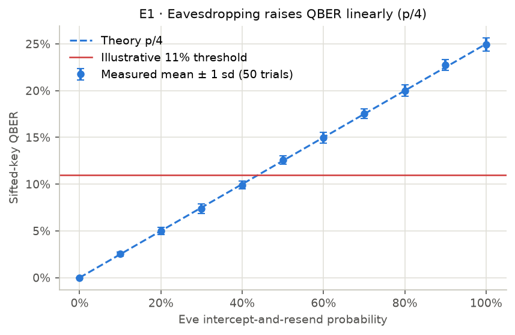
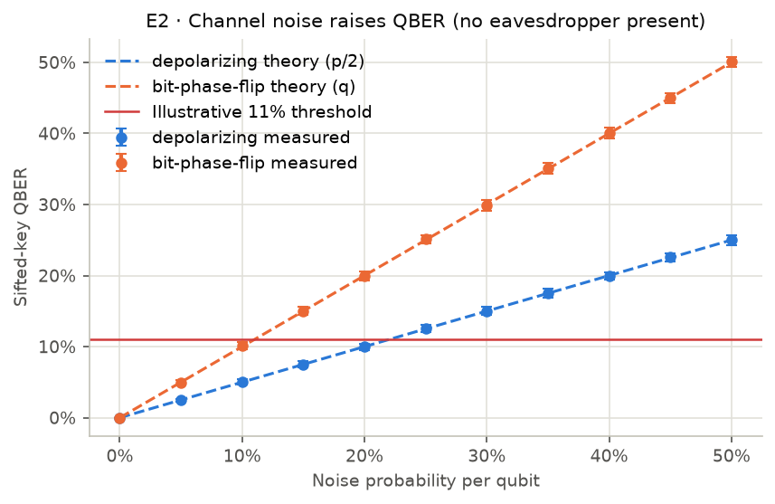
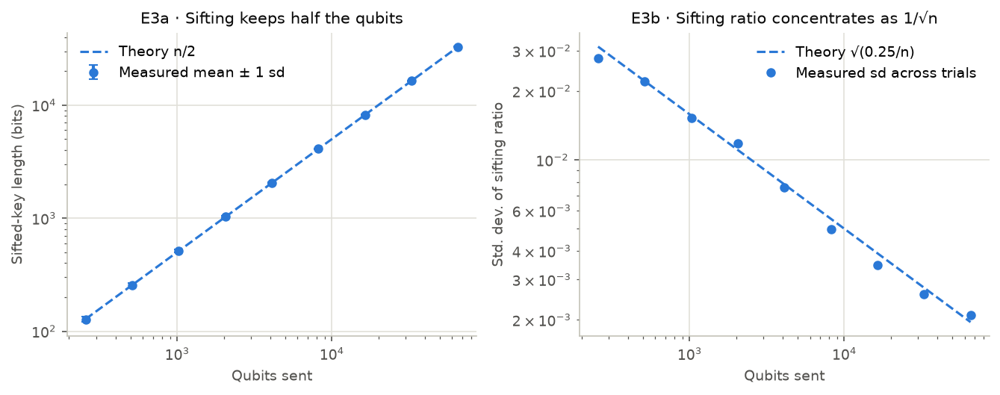
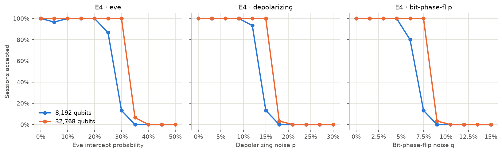
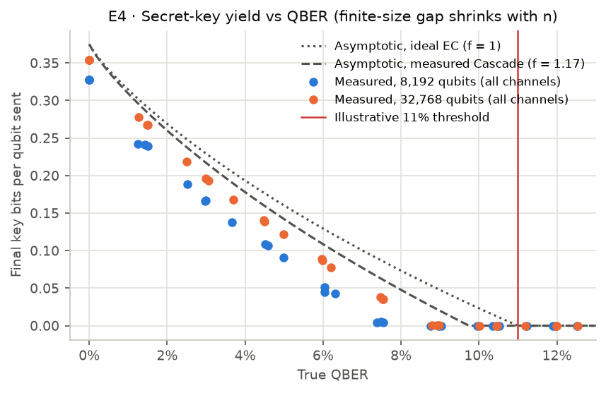
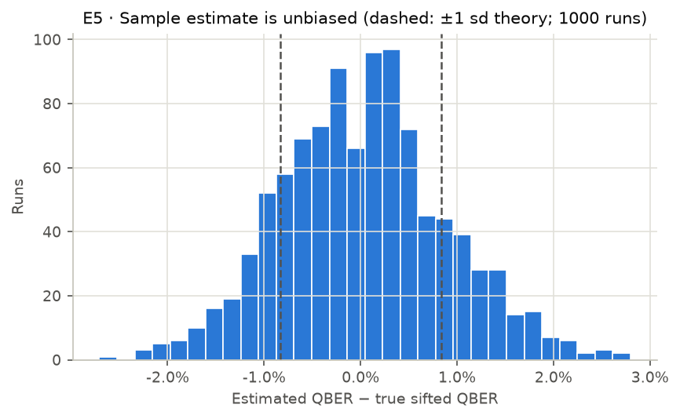
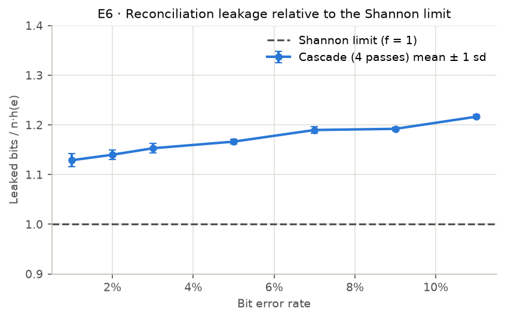
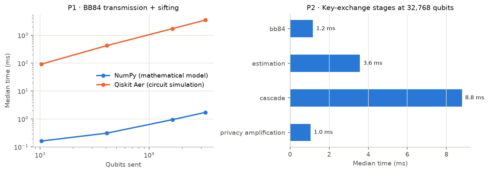

# Generated Results

> Generated by `dev.py experiment final_evaluation` (full mode, root seed **2024**) on 2026-10-21T18:15:02+00:00 in 90.1 s. Every value below is computed from simulator runs recorded in `results.json`; nothing is entered by hand. Re-running with the same seed and package versions reproduces the experiment tables exactly (timings vary by machine).

## Environment

| Item | Value |
|---|---|
| Platform | macOS-15.3.1-arm64-arm-64bit |
| Processor | arm |
| CPU cores | 8 |
| Python | 3.12.13 |
| numpy | 2.5.4 |
| qiskit | 2.6.0 |
| qiskit-aer | 0.18.0 |
| cryptography | 50.0.2 |
| fastapi | 0.158.0 |
| SQLAlchemy | 2.1.6 |

## Statistical validation against theory

z = (measured mean − theory) / (sd/√trials). Under correct modelling |z| > 3 should occur in roughly 0.3% of points.

| Check | Points | max |z| | Points with |z| > 3 |
|---|---|---|---|
| E1 Eve vs QBER | 11 | 2.98 | 0 |
| E2 depolarizing vs QBER | 11 | 1.35 | 0 |
| E2 bit-phase flip vs QBER | 11 | 1.43 | 0 |
| E3 sifted length vs n/2 | 9 | 1.12 | 0 |
| E7 Qiskit vs theory | 4 | 1.01 | 0 |
| E7 Qiskit vs NumPy (two-sample) | 4 | 0.69 | 0 |

## E1 · Eve intercept probability vs QBER

8,192 qubits, 50 trials per point.

| Eve p | QBER mean | ± sd | Theory p/4 | z | Eve knows (sifted) |
|---|---|---|---|---|---|
| 0% | 0.00% | 0.00% | 0.00% | +0.00 | 0.0% |
| 10% | 2.53% | 0.23% | 2.50% | +0.77 | 5.0% |
| 20% | 5.00% | 0.41% | 5.00% | +0.05 | 10.1% |
| 30% | 7.38% | 0.49% | 7.50% | -1.78 | 15.0% |
| 40% | 9.91% | 0.41% | 10.00% | -1.53 | 20.0% |
| 50% | 12.60% | 0.45% | 12.50% | +1.53 | 25.2% |
| 60% | 14.96% | 0.57% | 15.00% | -0.51 | 30.0% |
| 70% | 17.55% | 0.53% | 17.50% | +0.65 | 35.1% |
| 80% | 20.00% | 0.62% | 20.00% | +0.01 | 40.2% |
| 90% | 22.74% | 0.57% | 22.50% | +2.98 | 44.8% |
| 100% | 24.94% | 0.73% | 25.00% | -0.57 | 50.1% |

## E2 · Channel noise vs QBER

**depolarizing** (theory p/2)

| Noise | QBER mean | ± sd | Theory | z |
|---|---|---|---|---|
| 0% | 0.00% | 0.00% | 0.00% | +0.00 |
| 5% | 2.47% | 0.20% | 2.50% | -1.26 |
| 10% | 5.07% | 0.36% | 5.00% | +1.35 |
| 15% | 7.52% | 0.42% | 7.50% | +0.27 |
| 20% | 9.96% | 0.46% | 10.00% | -0.53 |
| 25% | 12.55% | 0.53% | 12.50% | +0.72 |
| 30% | 14.99% | 0.58% | 15.00% | -0.13 |
| 35% | 17.55% | 0.65% | 17.50% | +0.50 |
| 40% | 19.93% | 0.56% | 20.00% | -0.91 |
| 45% | 22.56% | 0.62% | 22.50% | +0.73 |
| 50% | 25.00% | 0.71% | 25.00% | -0.04 |

**bit-phase-flip** (theory q)

| Noise | QBER mean | ± sd | Theory | z |
|---|---|---|---|---|
| 0% | 0.00% | 0.00% | 0.00% | +0.00 |
| 5% | 4.98% | 0.30% | 5.00% | -0.55 |
| 10% | 10.10% | 0.51% | 10.00% | +1.43 |
| 15% | 15.00% | 0.55% | 15.00% | -0.00 |
| 20% | 19.96% | 0.67% | 20.00% | -0.43 |
| 25% | 25.10% | 0.57% | 25.00% | +1.26 |
| 30% | 29.92% | 0.77% | 30.00% | -0.73 |
| 35% | 35.07% | 0.78% | 35.00% | +0.64 |
| 40% | 40.01% | 0.75% | 40.00% | +0.05 |
| 45% | 45.01% | 0.70% | 45.00% | +0.08 |
| 50% | 50.08% | 0.71% | 50.00% | +0.80 |

## E3 · Qubits sent vs sifted-key length

| Qubits | Sifted mean | Ratio mean | Ratio sd | Theory sd √(0.25/n) | z (vs n/2) |
|---|---|---|---|---|---|
| 256 | 127.5 | 0.4979 | 0.0278 | 0.0312 | -0.54 |
| 512 | 256.5 | 0.5011 | 0.0219 | 0.0221 | +0.34 |
| 1,024 | 509.9 | 0.4979 | 0.0152 | 0.0156 | -0.95 |
| 2,048 | 1025.8 | 0.5009 | 0.0118 | 0.0110 | +0.53 |
| 4,096 | 2052.9 | 0.5012 | 0.0076 | 0.0078 | +1.12 |
| 8,192 | 4099.8 | 0.5005 | 0.0050 | 0.0055 | +0.67 |
| 16,384 | 8188.1 | 0.4998 | 0.0035 | 0.0039 | -0.48 |
| 32,768 | 16377.0 | 0.4998 | 0.0026 | 0.0028 | -0.58 |
| 65,536 | 32765.8 | 0.5000 | 0.0021 | 0.0020 | -0.11 |

## E4 · Key acceptance and secret-key yield

Full pipeline per run: sampling (25%), abort rule (11%), Cascade, Toeplitz privacy amplification, ≥ 256-bit minimum. *Secret fraction* counts aborted runs as 0.

**eve**, 8,192 qubits, 30 trials

| Value | Accepted | Est. QBER | True QBER | Final bits (accepted) | Bits / qubit | Keys match | Abort reasons |
|---|---|---|---|---|---|---|---|
| 0.0% | 100% | 0.00% | 0.00% | 2684 | 0.3276 | yes | — |
| 5.0% | 97% | 1.22% | 1.25% | 2054 | 0.2423 | yes | reconciliation_failed: 1 |
| 10.0% | 100% | 2.52% | 2.51% | 1545 | 0.1886 | yes | — |
| 15.0% | 100% | 3.83% | 3.67% | 1126 | 0.1374 | yes | — |
| 20.0% | 100% | 4.97% | 4.99% | 743 | 0.0907 | yes | — |
| 25.0% | 87% | 6.18% | 6.31% | 410 | 0.0434 | yes | insufficient_key: 4 |
| 30.0% | 13% | 7.38% | 7.37% | 293 | 0.0048 | yes | insufficient_key: 26 |
| 35.0% | 0% | 8.77% | 8.75% | 0 | 0.0000 | yes | insufficient_key: 29, qber_above_threshold: 1 |
| 40.0% | 0% | 10.00% | 9.96% | 0 | 0.0000 | yes | qber_above_threshold: 4, insufficient_key: 26 |
| 45.0% | 0% | 11.01% | 11.23% | 0 | 0.0000 | yes | qber_above_threshold: 15, insufficient_key: 15 |
| 50.0% | 0% | 12.42% | 12.52% | 0 | 0.0000 | yes | qber_above_threshold: 27, insufficient_key: 3 |

**depolarizing**, 8,192 qubits, 30 trials

| Value | Accepted | Est. QBER | True QBER | Final bits (accepted) | Bits / qubit | Keys match | Abort reasons |
|---|---|---|---|---|---|---|---|
| 0.0% | 100% | 0.00% | 0.00% | 2684 | 0.3276 | yes | — |
| 3.0% | 100% | 1.43% | 1.44% | 1973 | 0.2409 | yes | — |
| 6.0% | 100% | 3.12% | 2.96% | 1356 | 0.1656 | yes | — |
| 9.0% | 100% | 4.41% | 4.60% | 878 | 0.1072 | yes | — |
| 12.0% | 93% | 6.06% | 6.04% | 454 | 0.0517 | yes | insufficient_key: 2 |
| 15.0% | 13% | 7.45% | 7.54% | 285 | 0.0046 | yes | insufficient_key: 26 |
| 18.0% | 0% | 8.98% | 8.97% | 0 | 0.0000 | yes | insufficient_key: 29, qber_above_threshold: 1 |
| 21.0% | 0% | 10.24% | 10.36% | 0 | 0.0000 | yes | insufficient_key: 25, qber_above_threshold: 5 |
| 24.0% | 0% | 11.93% | 11.90% | 0 | 0.0000 | yes | qber_above_threshold: 25, insufficient_key: 5 |
| 27.0% | 0% | 13.59% | 13.57% | 0 | 0.0000 | yes | qber_above_threshold: 30 |
| 30.0% | 0% | 14.88% | 14.99% | 0 | 0.0000 | yes | qber_above_threshold: 30 |

**bit-phase-flip**, 8,192 qubits, 30 trials

| Value | Accepted | Est. QBER | True QBER | Final bits (accepted) | Bits / qubit | Keys match | Abort reasons |
|---|---|---|---|---|---|---|---|
| 0.0% | 100% | 0.00% | 0.00% | 2684 | 0.3276 | yes | — |
| 1.5% | 100% | 1.37% | 1.51% | 1963 | 0.2396 | yes | — |
| 3.0% | 100% | 3.01% | 2.99% | 1370 | 0.1673 | yes | — |
| 4.5% | 100% | 4.44% | 4.51% | 894 | 0.1091 | yes | — |
| 6.0% | 80% | 6.32% | 6.04% | 462 | 0.0451 | yes | insufficient_key: 6 |
| 7.5% | 13% | 7.51% | 7.50% | 308 | 0.0050 | yes | insufficient_key: 26 |
| 9.0% | 0% | 8.86% | 9.02% | 0 | 0.0000 | yes | insufficient_key: 30 |
| 10.5% | 0% | 10.61% | 10.51% | 0 | 0.0000 | yes | qber_above_threshold: 10, insufficient_key: 20 |
| 12.0% | 0% | 11.76% | 11.97% | 0 | 0.0000 | yes | qber_above_threshold: 23, insufficient_key: 7 |
| 13.5% | 0% | 13.57% | 13.52% | 0 | 0.0000 | yes | qber_above_threshold: 30 |
| 15.0% | 0% | 14.96% | 15.06% | 0 | 0.0000 | yes | qber_above_threshold: 30 |

**eve**, 32,768 qubits, 30 trials

| Value | Accepted | Est. QBER | True QBER | Final bits (accepted) | Bits / qubit | Keys match | Abort reasons |
|---|---|---|---|---|---|---|---|
| 0.0% | 100% | 0.00% | 0.00% | 11610 | 0.3543 | yes | — |
| 5.0% | 100% | 1.30% | 1.27% | 9096 | 0.2776 | yes | — |
| 10.0% | 100% | 2.52% | 2.50% | 7177 | 0.2190 | yes | — |
| 15.0% | 100% | 3.79% | 3.70% | 5498 | 0.1678 | yes | — |
| 20.0% | 100% | 4.98% | 4.98% | 3996 | 0.1220 | yes | — |
| 25.0% | 100% | 6.30% | 6.20% | 2540 | 0.0775 | yes | — |
| 30.0% | 100% | 7.60% | 7.54% | 1161 | 0.0354 | yes | — |
| 35.0% | 7% | 8.76% | 8.80% | 342 | 0.0007 | yes | insufficient_key: 28 |
| 40.0% | 0% | 10.05% | 10.01% | 0 | 0.0000 | yes | insufficient_key: 29, qber_above_threshold: 1 |
| 45.0% | 0% | 11.24% | 11.20% | 0 | 0.0000 | yes | qber_above_threshold: 21, insufficient_key: 9 |
| 50.0% | 0% | 12.29% | 12.53% | 0 | 0.0000 | yes | qber_above_threshold: 30 |

**depolarizing**, 32,768 qubits, 30 trials

| Value | Accepted | Est. QBER | True QBER | Final bits (accepted) | Bits / qubit | Keys match | Abort reasons |
|---|---|---|---|---|---|---|---|
| 0.0% | 100% | 0.00% | 0.00% | 11610 | 0.3543 | yes | — |
| 3.0% | 100% | 1.47% | 1.49% | 8762 | 0.2674 | yes | — |
| 6.0% | 100% | 3.15% | 3.06% | 6342 | 0.1935 | yes | — |
| 9.0% | 100% | 4.53% | 4.49% | 4561 | 0.1392 | yes | — |
| 12.0% | 100% | 5.93% | 5.98% | 2855 | 0.0871 | yes | — |
| 15.0% | 100% | 7.45% | 7.47% | 1254 | 0.0383 | yes | — |
| 18.0% | 3% | 9.02% | 8.97% | 486 | 0.0005 | yes | insufficient_key: 29 |
| 21.0% | 0% | 10.47% | 10.46% | 0 | 0.0000 | yes | insufficient_key: 28, qber_above_threshold: 2 |
| 24.0% | 0% | 12.17% | 12.00% | 0 | 0.0000 | yes | qber_above_threshold: 30 |
| 27.0% | 0% | 13.65% | 13.53% | 0 | 0.0000 | yes | qber_above_threshold: 30 |
| 30.0% | 0% | 14.84% | 14.99% | 0 | 0.0000 | yes | qber_above_threshold: 30 |

**bit-phase-flip**, 32,768 qubits, 30 trials

| Value | Accepted | Est. QBER | True QBER | Final bits (accepted) | Bits / qubit | Keys match | Abort reasons |
|---|---|---|---|---|---|---|---|
| 0.0% | 100% | 0.00% | 0.00% | 11610 | 0.3543 | yes | — |
| 1.5% | 100% | 1.47% | 1.50% | 8752 | 0.2671 | yes | — |
| 3.0% | 100% | 3.07% | 3.00% | 6434 | 0.1963 | yes | — |
| 4.5% | 100% | 4.42% | 4.48% | 4613 | 0.1408 | yes | — |
| 6.0% | 100% | 5.83% | 5.97% | 2907 | 0.0887 | yes | — |
| 7.5% | 100% | 7.57% | 7.53% | 1173 | 0.0358 | yes | — |
| 9.0% | 3% | 8.92% | 8.92% | 418 | 0.0004 | yes | insufficient_key: 29 |
| 10.5% | 0% | 10.55% | 10.45% | 0 | 0.0000 | yes | insufficient_key: 26, qber_above_threshold: 4 |
| 12.0% | 0% | 11.90% | 11.98% | 0 | 0.0000 | yes | qber_above_threshold: 30 |
| 13.5% | 0% | 13.37% | 13.51% | 0 | 0.0000 | yes | qber_above_threshold: 30 |
| 15.0% | 0% | 14.96% | 15.04% | 0 | 0.0000 | yes | qber_above_threshold: 30 |

## E5 · QBER estimation accuracy

| Metric | Value |
|---|---|
| Runs | 1000 |
| Channel | depolarizing 0.1 → error probability 5.0% |
| Mean test-sample size | 512 bits |
| Mean (estimate − true) | +0.031 pp |
| Sd (estimate − true) | 0.862 pp (theory ≈ 0.834 pp) |
| Clopper–Pearson 99.9% upper bound ≥ true error probability | 100.0% |

## E6 · Cascade reconciliation

| Error rate | Leak / n·h(e) | ± sd | Leaked bits | Shannon limit | Residual errors | Verified |
|---|---|---|---|---|---|---|
| 1% | 1.129 | 0.013 | 908 | 808 | 0 | 100% |
| 2% | 1.140 | 0.009 | 1616 | 1414 | 0 | 100% |
| 3% | 1.153 | 0.009 | 2242 | 1944 | 0 | 100% |
| 5% | 1.166 | 0.005 | 3323 | 2864 | 0 | 100% |
| 7% | 1.190 | 0.006 | 4362 | 3659 | 0 | 100% |
| 9% | 1.192 | 0.003 | 5176 | 4365 | 0 | 100% |
| 11% | 1.217 | 0.004 | 6046 | 4999 | 0 | 100% |

10,000-bit keys, 20 trials per rate.

## E7 · NumPy model vs Qiskit Aer circuits

| Eve p | NumPy QBER | Qiskit QBER | Theory | Difference | z (two-sample) | Qiskit z vs theory |
|---|---|---|---|---|---|---|
| 0% | 0.00% | 0.00% | 0.00% | +0.00 pp | +0.00 | +0.00 |
| 25% | 6.30% | 6.19% | 6.25% | -0.10 pp | -0.69 | -0.51 |
| 50% | 12.68% | 12.64% | 12.50% | -0.04 pp | -0.16 | +0.93 |
| 100% | 24.97% | 24.82% | 25.00% | -0.15 pp | -0.56 | -1.01 |

## Performance (this machine)

**P1 · BB84 transmission + sifting** (Eve 50%, depolarizing 5%)

| Backend | Qubits | Median ms | p95 ms | Qubits / s |
|---|---|---|---|---|
| numpy | 1,024 | 0.16 | 0.30 | 6,312,883 |
| qiskit | 1,024 | 91.96 | 92.77 | 11,136 |
| numpy | 4,096 | 0.31 | 0.38 | 13,149,278 |
| qiskit | 4,096 | 425.67 | 430.62 | 9,622 |
| numpy | 16,384 | 0.95 | 1.11 | 17,253,127 |
| qiskit | 16,384 | 1722.81 | 1745.06 | 9,510 |
| numpy | 32,768 | 1.72 | 1.82 | 19,018,456 |
| qiskit | 32,768 | 3478.17 | 3576.36 | 9,421 |

**P2 · Key-exchange stage medians (ms)**

| Qubits | BB84 | Estimation | Cascade | Privacy amp. | Total |
|---|---|---|---|---|---|
| 8,192 | 0.38 | 1.27 | 2.26 | 0.31 | 4.23 |
| 32,768 | 1.17 | 3.58 | 8.79 | 1.05 | 14.59 |

**P3 · Classical cryptography** (256-byte payload, 5000 operations)

| Operation | Median µs | p95 µs |
|---|---|---|
| HKDF-SHA256: derive session keys | 24.6 | 27.6 |
| AES-256-GCM encrypt | 1.6 | 2.0 |
| AES-256-GCM decrypt + verify | 0.9 | 1.0 |

**P4 · End-to-end transfer** (fresh 4,096-qubit QKD session + HKDF + AES-GCM + SQLite writes, 30 transfers): median **3.1 ms**, p95 3.7 ms.

